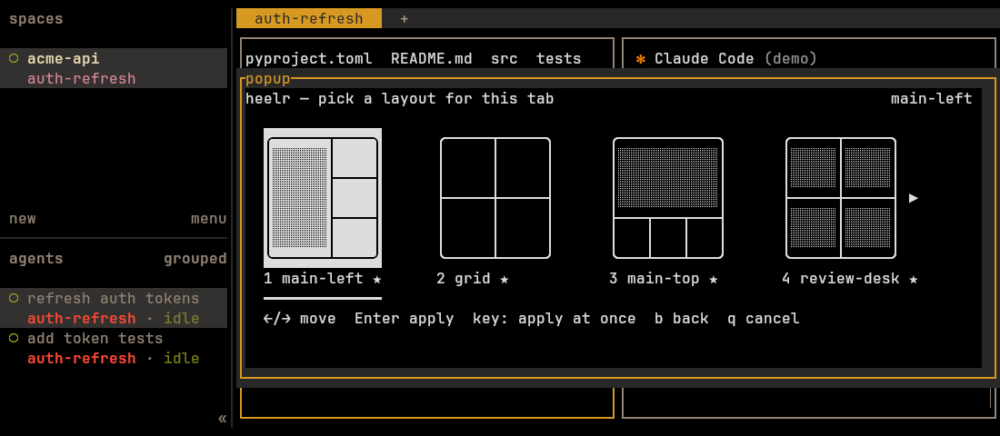
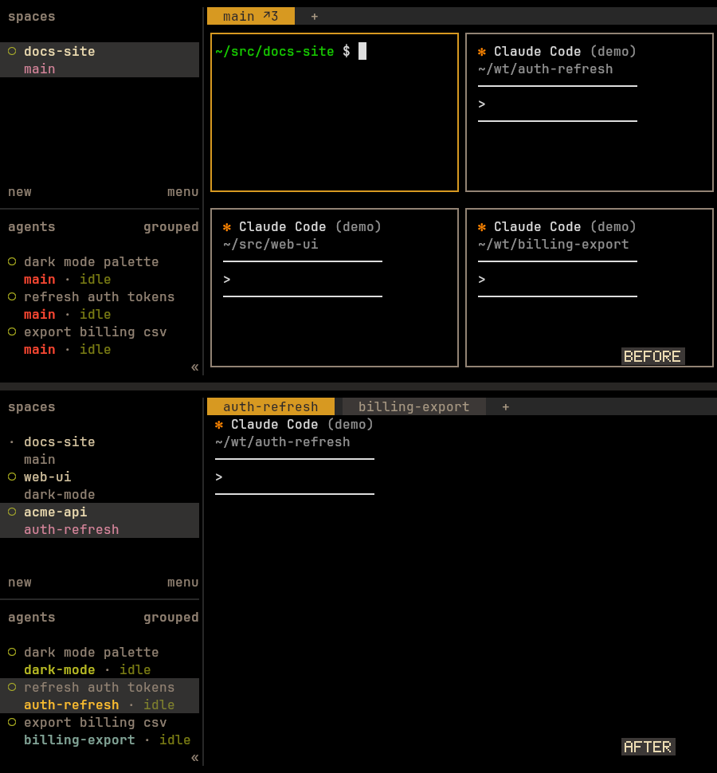
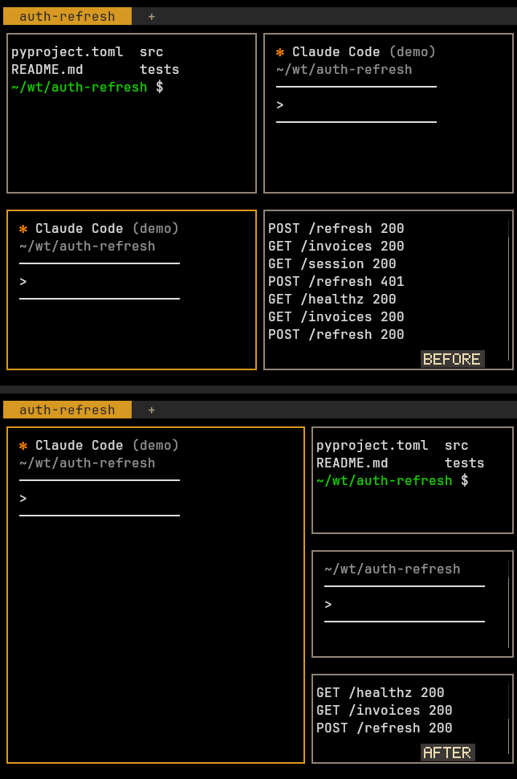
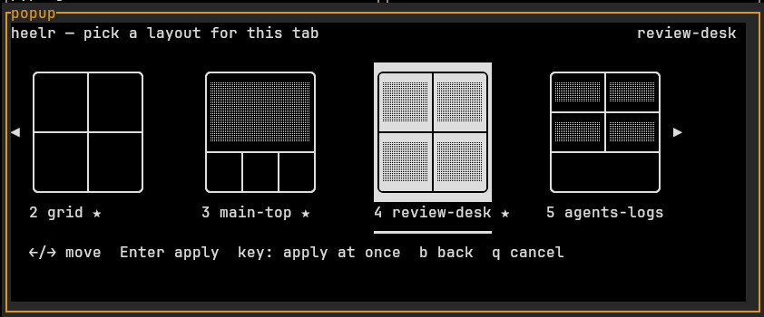
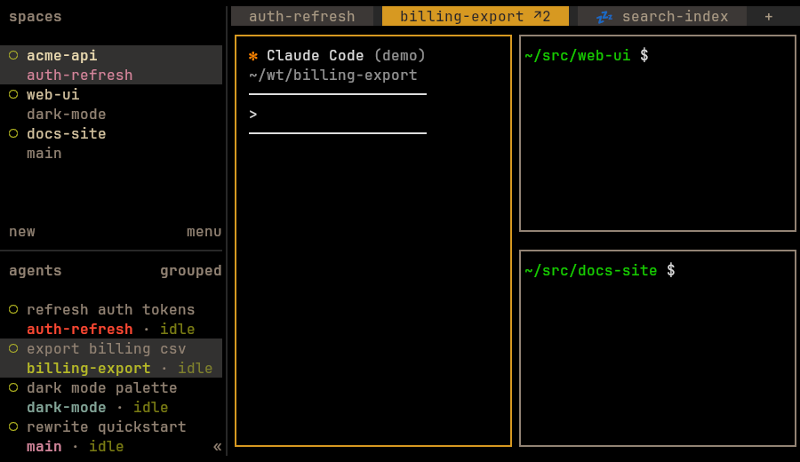
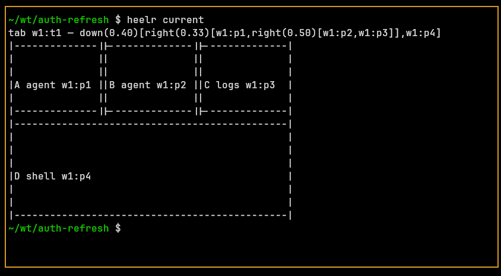

# heelr

Role placement for [Herdr](https://herdr.dev): agents' panes go to the right workspace and
tab for their repo and task (off by default). Layouts come second: heelr rearranges the panes
you already have (no restarts) into a saved or preset shape.
**Start with the [user guide](docs/USER_GUIDE.md).**



```
heelr list                   # presets + ~/.config/heelr/layouts/*.toml
heelr show grid -n 5         # draw a layout
heelr current                # draw the focused tab, with detected roles
heelr apply main-left [-n]   # rearrange the focused tab (-n = dry run)
heelr back                   # undo the last apply on this tab (toggles)
heelr save mine              # capture the tab to an editable fixed layout
heelr save ws --tabs         # capture the whole workspace as a multi-tab layout
heelr promote                # swap the focused pane with the largest one
heelr nudge + | -             # grow / shrink the main area by 10% (remembered per tab)
heelr auto-toggle            # auto-tile off / on for this tab
heelr sleep | wake            # end this tab's idle, named Claude agents / resume them
heelr sleep-toggle           # wake if asleep, else sleep (what prefix+shift+z runs)
heelr auto                   # re-tile laid-out tabs (run by the plugin; needs auto_tile = true)
heelr pick                   # layout carousel (what prefix+m opens)
heelr selftest [--record]    # live tests on a throwaway Herdr server
heelr check-update           # newer Herdr out? server restart pending?
heelr sort | pull TASK       # placement: move panes to their repo's workspace and task's tab (see the user guide)
```

`--tab <id>` targets a tab other than the focused one.

## Features

<table>
<tr>
<td valign="top" width="36%">

#### Role placement

Agents' panes move to the workspace and tab for their repo and task.

`heelr sort`, `heelr pull TASK`

</td>
<td></td>
</tr>
<tr>
<td></td>
<td valign="top" width="36%">

#### Layouts

Rearrange the panes you already have into a preset or saved shape. No restarts; undo any time.

`heelr apply main-left`, undo with `heelr back`

</td>
</tr>
<tr>
<td valign="top" width="36%">

#### Layout carousel

Browse presets and your saved layouts in a popup, then apply one with Enter.

`prefix+m` (or `heelr pick`)

</td>
<td></td>
</tr>
<tr>
<td></td>
<td valign="top" width="36%">

#### Sleep, tab marks, tab colours

A 💤 marks a sleeping tab. ` ↗N` counts the panes in a tab that belong elsewhere. The tab-colours plugin gives each tab a stable colour in the sidebar.

`prefix+shift+z` to sleep or wake; marks and colours are automatic

</td>
</tr>
<tr>
<td valign="top" width="36%">

#### Inspect

Draw the focused tab with each pane's detected role, or draw any layout.

`heelr current`, `heelr show grid -n 5`

</td>
<td></td>
</tr>
</table>

## Requirements

- [Herdr](https://herdr.dev), tested on 0.9.1 and 0.9.3 (`heelr/tested_versions.txt`).
- Python 3.11+, stdlib only.
- Linux. macOS is untested.

## Install

```sh
git clone https://github.com/spencer2211/heelr.git
cd heelr
ln -s "$PWD/bin/heelr" ~/.local/bin/heelr   # or any directory on your PATH
```

Then add the key bindings from the Keys section below to your Herdr config.

## Keys (in `~/.config/herdr/config.toml`)

- `prefix+m` — layout carousel: ←/→ and Enter, or a layout's key applies at once (`b` back, `q` cancel).
- `prefix+u` — undo the last layout change.
- `prefix+Enter` — promote: swap the focused pane with the largest one.
- `prefix+=` / `prefix+-` — nudge the main area bigger / smaller.
- `prefix+a` — auto-tile off / on for this tab.
- `prefix+shift+z` — sleep / wake this tab's Claude agents (frees their memory; all must be named and idle).

The bindings:

```toml
[[keys.command]]
key = "prefix+m"
type = "popup"
command = "heelr pick"
width = 96
height = 16

[[keys.command]]
key = "prefix+u"
type = "shell"
command = "heelr back"

[[keys.command]]
key = "prefix+enter"
type = "shell"
command = "heelr promote"

[[keys.command]]
key = "prefix+="
type = "shell"
command = "heelr nudge +"

[[keys.command]]
key = "prefix+-"
type = "shell"
command = "heelr nudge -"

[[keys.command]]
key = "prefix+a"
type = "shell"
command = "heelr auto-toggle"

[[keys.command]]
key = "prefix+shift+z"
type = "shell"
command = "heelr sleep-toggle"
```

**Auto-tile** (off unless `auto_tile = true` in `~/.config/heelr/config.toml`): a tab you've
laid out keeps its layout as panes open and close. A new pane joins the end of the stack; if
main closes, the top of the stack moves up. It runs from the heelr Herdr plugin
(`plugins/tab-colours/`, which also does tab colours).

Favourites: `favourites = ["main-left", "grid", ...]` in `~/.config/heelr/config.toml`.
Errors (and notes like "already main") from the background bindings show as a Herdr notification.

- **Presets** (rule layouts, any pane count): `main-left`, `main-top`,
  `main-right`, `main-bottom`, `main-left-grid`, `main-center`, `two-mains`, `agents-logs`
  (agents on top, the rest below), `grid`, `even-columns`, `even-rows`.
  All but `grid` have `add_missing = true`: on a tab with too few panes
  (e.g. one) they open new shells to show the shape; `back` closes them.
  Turn it off by overriding the preset in `~/.config/heelr/layouts/`.
- **Picker** (`heelr pick`) shows one scrolling row of box-drawing thumbnails,
  starting on the tab's current layout; a plain list if the popup is too small.
- **Fixed layouts** are binary trees; `ratio` is the first child's share.
  `on_mismatch = "fill"` creates shells for empty slots and moves extra panes
  to an `overflow` tab; `refuse` (default) changes nothing.
- **Multi-tab layouts** (`kind = "multi"`, see `examples/fleet.toml`) gather panes
  into labelled tabs by role from anywhere in the workspace, then lay out each tab.
  Unclaimed panes go to `park_tab`. `back` undoes whichever kind of change was
  last in the workspace.
- **Placement** (off by default): panes go to the workspace and tab their repo and task belong to.
- **Roles** (`agent`, `logs`, `shell`) steer which pane lands in which slot;
  override with `~/.config/heelr/roles.toml` (see `roles.example.toml`).
- Nothing you started is ever closed (`back` closes only idle panes heelr
  created). Herdr 0.9.1 ignores same-tab `pane move`, so an apply
  parks panes in a temporary `heelr-park` tab and moves them back; that tab
  closes itself when empty.
- Only runs on tested Herdr versions: `heelr/tested_versions.txt` plus
  `~/.config/heelr/tested-versions`. Any untested patch release of a tested
  major.minor (0.9.2 or 0.9.4 when 0.9.3 is tested) runs with a warning; a new
  minor/major is refused.
- `heelr check-update` exits 0 up to date, 10 update available, 11 server
  restart pending, 1 error. Read-only.

Tests: `python3 -m pytest` (offline) and `heelr selftest` (the live tests in
`tests/test_live.py`, on a throwaway Herdr server with its own `HOME`; never the
running one). After a Herdr upgrade, `heelr selftest --record` marks the
version tested.

## Tab colours plugin

`plugins/tab-colours/` is a Herdr plugin that colours each tab's name in the
sidebar agent list with a stable, distinct colour, automatically. Install:
from your clone, `herdr plugin link "$PWD/plugins/tab-colours"`, then put the output of
`python3 plugins/tab-colours/tab_colours.py sidebar` in your
`[ui.sidebar.agents]`. See "Tab colours" in `docs/USER_GUIDE.md`.

## Tab marks

heelr appends ` ↗N` for N panes in a tab that belong elsewhere, and prefixes `💤 ` to a
sleeping tab. A plugin that sets tab labels should strip both: the suffix matches the regex
` ↗\d+$`, and the prefix is the literal `💤 `.

## Contributing and licence

See [CONTRIBUTING.md](CONTRIBUTING.md) and [SECURITY.md](SECURITY.md). MIT, see [LICENSE](LICENSE).
